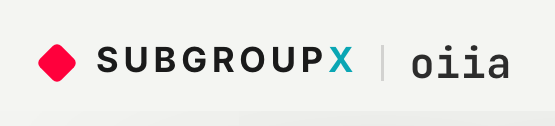
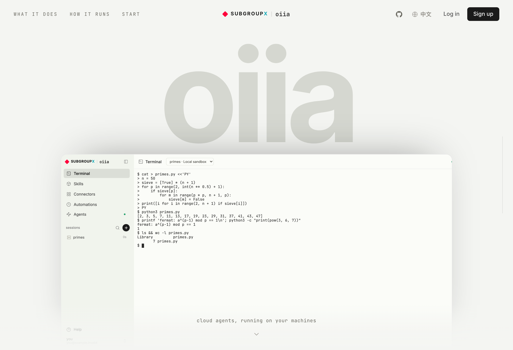
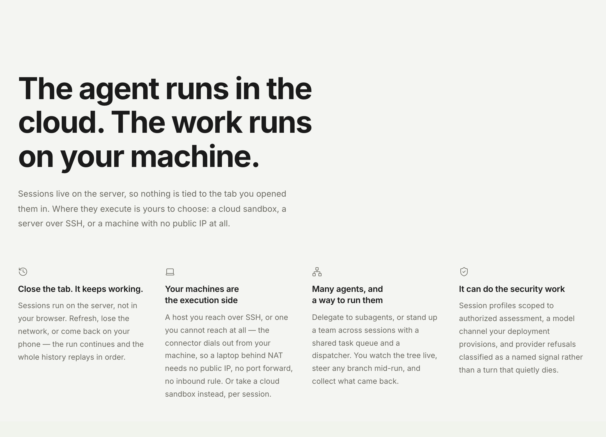
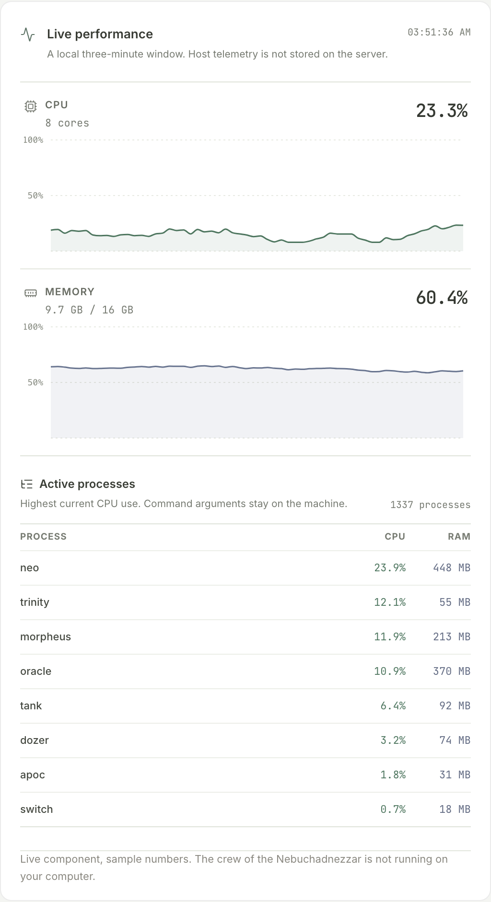

<picture>
  <source media="(prefers-color-scheme: dark)" srcset="assets/lockup-dark.png">
  
</picture>

**The agent runs in the cloud. The work runs on your machine.**

*oiia* is the product. *SubgroupX* is the team that builds it. The mark above is the same lockup the
app wears in its own top-left corner, captured from the running product rather than redrawn.

<picture>
  <source media="(prefers-color-scheme: dark)" srcset="assets/landing-hero-dark.png">
  
</picture>

oiia is a multi-user agent platform you reach from a browser. Sessions are durable server-side
objects, not browser state — but the interesting part is the other end. **Where a session executes is
a per-session choice, and that includes machines nobody can route to.**

<picture>
  <source media="(prefers-color-scheme: dark)" srcset="assets/landing-claims-dark.png">
  
</picture>

## What it is for

**Your machines are the execution side.** Four sandbox backends sit behind one `Sandbox` interface,
and a session picks one at creation:

| Backend | Reaches | How |
|---|---|---|
| `connector` | **a machine with no public IP** | a daemon you run dials *out* over WebSocket; the server never initiates. No port forward, no inbound rule, no VPN. |
| `ssh` | a host you have a key for | ordinary outbound SSH from the server, with its own guard and unlock path |
| `e2b` | a disposable cloud VM | isolated exec and files, idle-paused with state preserved |
| `local` | the server itself | path-scoped working directory; bwrap on Linux, seatbelt on macOS |

The connector is the one worth the paragraph. A laptop behind NAT, a lab box on a corporate network,
a machine that exists only on Tailscale — the agent works *there*, on the real files, in place. The UI
is identical across all four: same file tree, same interactive terminal, same approval gate. Swapping
the target does not change how you work.

<picture>
  <source media="(prefers-color-scheme: dark)" srcset="assets/landing-machine-dark.png">
  
</picture>

That panel is not a screenshot on the landing page — it is the shipped component, running, on numbers
declared as sample. `check:layout` forbids the module it lives in from importing the API client at
all, so "the public page never attempts an authenticated request" is a property of the module graph
rather than a claim in a comment.

**Many agents, and a way to run them.** `spawn_subagent` delegates to a child whose run streams as a
nested timeline. Beyond that there is durable orchestration: an agent tree persisted in SQLite, a
task queue with a permit-based dispatcher, agent *teams* that span sessions with a shared queue, and
declarative workflows. Agents are addressable — you can steer one mid-run, follow up on a finished
one, and see the whole tree live rather than discovering at the end what your fleet did.

**It can do the security work.** Alongside the default coding profile, a session can be created under
a profile scoped to authorized assessment. A deployment may provision its own model channel for those
profiles rather than depending on a consumer endpoint, and provider refusals are classified as a
named signal — surfaced to you and to the agent as a specific outcome, instead of a turn that stops
with no explanation. The E2B template ships the tooling to match: Java 8/11, recon tools with
SecLists, WASM reversing (wabt, wasm-tools, binaryen, twiggy, wasmtime/wasmer), mise/uv, playwright,
and the lynx/w3m text browsers.

**Sessions outlive the tab.** They run on the server. Refresh, lose the network, deploy over them, or
come back on a phone — the run continues and the whole history replays in order. The database is the
source of truth and the live runtime is a rebuildable cache, which is what makes idle-release,
session-switch, redeploy and rewind the same operation: dispose, then lazily rehydrate.

**Every device, nothing to download.** It is a PWA: `display: standalone`, maskable icons, and a
service worker that caches the shell and assets per build, so it installs to the home screen on iOS
and Android straight from the browser — no app store, no APK, no TestFlight. Installed or not, it is
the same app against the same sessions, which is the part that matters: start something on a laptop,
watch it from a phone on the train, approve a command from a tablet. There is no sync protocol to go
wrong because there is nothing to sync — the session was never on your device to begin with.

*Also included, because a product needs them but nobody switches tools for them:* a workspace file
tree with preview and uploads, three approval policies, reconnect with replay, MCP servers as
first-class tools, share links that redact secrets, an audit log, and Mermaid / KaTeX / syntax
highlighting in the transcript.

## How it is built

- **Server** — Node/Express + `ws`. SQLite (`node:sqlite`, WAL) is the source of truth.
- **Agent engine** — the `pi-mono` `Agent`. oiia is a stateful adapter around it, never a
  reimplementation. `pi-ai` supplies multi-provider streaming; `pi-agent-core` the turn loop.
- **Client** — a React SPA.
- **Shared** — one wire protocol and one *pure timeline reducer* that runs on both server and
  browser, so the two rebuild an identical timeline from the same events.
- **Ordering** — the runtime stamps every frame `(epoch, seq)`. The client converges on server truth
  and never invents ordering.
- **Two projections** — `timeline` (what you see) and `messages` (what the model sees), separated by
  one cut marker.

Placement and dependency rules are enforced rather than documented: `npm run check:layout` asserts
the source roots and the inward-only import direction, and fails the build when a module reaches
somewhere it should not.

## Running it

Needs Node 22.19–24 (the native PTY caps the upper bound; current pi/undici set the floor). CI and
deploy use 24.

```
npm install
npm --prefix web install
npm run build:web
PORT=4317 AGENT_WEB_DATA_DIR=./data npx tsx server/src/index.ts
```

Open http://localhost:4317, sign up, and create a session with the **Mock Coder** model — it needs no
key and understands directives, so you can drive the real tools offline: `/bash`, `/write <path>`,
`/read`, `/ls`, `/edit`, `/subagent <task>`, `/mcp`.

Users bring their own provider keys in Settings (encrypted AES-256-GCM at rest); any model `pi-ai`
supports then appears. An operator can additionally provision a shared channel that becomes the
default. **No upstream domain, model id or credential is compiled into this source tree** — an
unconfigured build simply leaves that channel dormant.

Dev mode with hot reload:

```
PORT=4317 npx tsx watch server/src/index.ts     # terminal 1
npm --prefix web run dev                         # terminal 2 (proxies /api and /ws)
```

### Environment

| Var | Default | Purpose |
|---|---|---|
| `PORT` | `4317` | HTTP/WS port |
| `AGENT_WEB_DATA_DIR` | `./data` | SQLite DB and per-session workspaces |
| `AGENT_WEB_SECRET` | random | JWT signing secret (set it for stable logins) |
| `AGENT_WEB_KEY_SECRET` | `AGENT_WEB_SECRET` | provider-key encryption secret |
| `AGENT_WEB_SEATBELT` | unset | `1` wraps bash in macOS `sandbox-exec` |
| `AGENT_WEB_MCP` | unset | JSON array of MCP servers |
| `AGENT_WEB_JAIL_KEY`, `_BASE_URL` | unset | operator model channel; both required, no endpoint fallback |
| `AGENT_WEB_JAIL_API`, `_MODEL` | `openai-responses`, none | operator API adapter, and its first/default model |
| `AGENT_WEB_JAIL_MODELS` | unset | additional operator models, exposed only after deployment verification |
| `AGENT_WEB_JAIL_MODEL_NAMES` | unset | `id=Display Name` pairs; unmapped ids display as themselves |
| `AGENT_WEB_JAIL_MODEL_LEVELS` | unset | `id=xhigh,max` pairs separated by `;` — which extra thinking efforts each operator model accepts. Unmapped ids offer low/medium/high only |
| `AGENT_WEB_E2B_KEY`, `_TEMPLATE` | unset | E2B cloud sandboxes |
| `AGENT_WEB_E2B_NEW_SESSION_DISABLED_REASON` | unset | `capacity` stops new E2B sessions while credits are unavailable; existing sandboxes still reconnect |
| `AGENT_WEB_EXA_KEY` | unset | exa MCP search server (skipped if unset) |
| `AGENT_WEB_GITHUB_CLIENT_ID`, `_SECRET` | unset | optional GitHub sign-in; dormant unless both are set |
| `AGENT_WEB_GOOGLE_CLIENT_ID`, `_SECRET` | unset | optional Google (OIDC) sign-in; needs a consent screen, legal pages and domain verification |
| `BUILD_VERSION` | `dev` | build id baked into the bundle and reported in `hello` |

## How a turn works

1. The client sends `send_message`. The runtime claims the turn, composes the toolset (connecting MCP
   servers the first time), and calls `agent.prompt`.
2. The pi `Agent` loop streams from the provider. Deltas become `assistant_*` and `tool_*` wire
   events tagged with a normalized `toolKind`.
3. Before each tool call the approval gate runs. Under `on-request` it emits a `permission_request`
   and blocks until the answer returns over the socket.
4. Approved tools run on the capability bus: built-ins in the chosen sandbox, MCP tools in their
   server, `spawn_subagent` as a nested child agent.
5. The loop ends when the model stops calling tools. Status goes `idle` and the transcript persists.

`shared/src/protocol.ts` has the wire types; `shared/src/timeline-reducer.ts` is the reducer both
sides run.

## Testing

There is no unit-test framework. Correctness is pinned by 141 Playwright cases that drive a real
browser against the real server, agent runtime, sandbox and filesystem, plus 120 `check:*` conformance
harnesses that assert contracts directly.

```
npm run e2e:install     # one-time: download Chromium
npm run e2e             # builds web, boots a server, runs the suite (mock model)
npm run e2e:real        # the same flows against a real model (skips without a key)
npm run test:resume     # timeline + transcript survive a full server restart
npm run typecheck       # server + web
npm run check:layout    # source placement and inward dependency boundaries
```

## Layout

```
shared/src/    dependency-free browser/server contract and timeline reducer
server/src/    composition roots + capability roots (http, identity, persistence, runtime, transport)
web/src/       app entrypoints + auth, conversation, dashboard, files, platform, share, ui
e2b/           sandbox template
test/          playwright configs + e2e/ (mock) and e2e-real/ (real model)
scripts/       deploy, profile and check:* harnesses; also the connector daemon users run
e2b/           sandbox template
```

## Thanks

- <a href="https://github.com/shuakami"> <b>shuakami</b></a> — the dashboard UI (PR #1), later reconciled onto the real backend.
- <a href="https://github.com/xwxb"> <b>xwxb</b></a> — tested and fixed compaction, and diagnosed what was actually wrong with subagent analysis.
- <a href="https://github.com/Lil-Ran"> <b>Lil-Ran</b></a> — performance work, and making the repository something worth looking at.
- <a href="https://github.com/ProbiusOfficial"> <b>ProbiusOfficial</b></a> and <a href="https://github.com/SEEMzx"> <b>SEEMzx</b></a> — read the repository front to back before launch.
- <a href="https://github.com/Kozmosa"> <b>Kozmosa</b></a> — told people about it, and told us what was wrong after actually using it.
- <a href="https://x.com/_toobug"><b>_toobug</b></a> — found a great many of the interaction problems, the kind that only show up when someone uses the thing properly.

## Notes

- The local sandbox isolates file operations but not arbitrary code. Use E2B, or a connector on a
  machine you are willing to hand over, for untrusted execution.
- New source files are capped at 1000 lines. The 23 that already exceeded it are frozen at their
  measured size by a shrink-only ratchet: they may get smaller, never larger, and an entry is deleted
  once the file comes under the ceiling for good.
- The commit history is SSH-signed.
